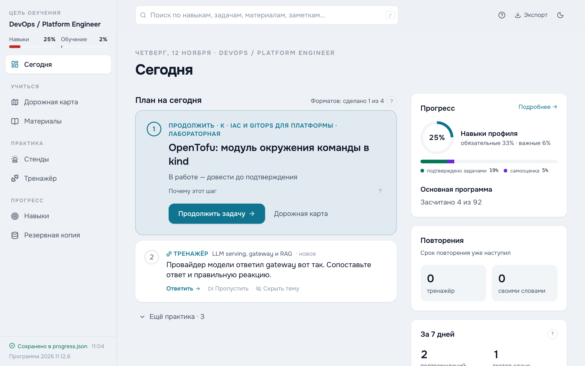
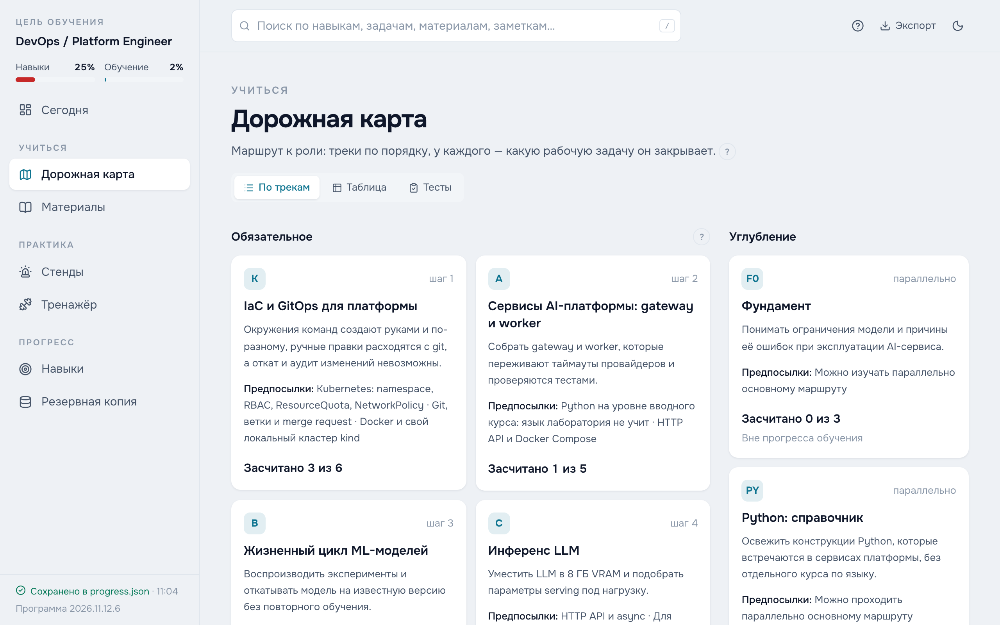
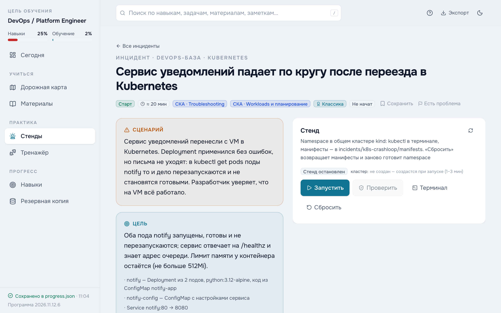

# HomeOps

[Русский](README.md) · **English**

> **The lab content is in Russian.** The interface, curriculum, questions, explanations and stand descriptions are Russian-only for now. Commands, configs, logs and tool output inside the stands are the usual English ones.

An open home lab for **DevOps / Platform Engineers** with an **ML/AI platform** specialization: a curriculum based on the job market, broken environments with automated checks, and a trainer with explained answers. Everything runs locally in Docker.

<picture>
  <source media="(prefers-color-scheme: dark)" srcset="docs/screenshots/today-dark.png">
  
</picture>

## Why

Trainers, broken environments and tests like these are usually sold for serious money. Here they are open, for anyone who wants to learn platform engineering hands-on, on their own machine.

- **The curriculum follows the market.** Skill profiles are built from an analysis of open job postings in Russia and abroad.
- **Practice is verified, not ticked off.** A stand is credited by an automated check of the system's final state; a task by its acceptance criteria and proof of the result.
- **Answers are explained.** Every option in the tests says why it is right or what misconception it reflects.
- **No fake progress.** Opening a page or ticking a box does not raise a skill level.

## Who it is for

Anyone who wants to practice DevOps and platform engineering skills, not just read about them.

- **If you are just starting**, begin with the «Старт» (Start) level stands on Linux, Docker and Kubernetes, the cheat sheets and the trainer: hints go from a general direction to specifics, and after you solve a stand the debrief explains what broke and why.
- **If you already work** with Linux, Docker, Kubernetes and CI/CD, the main curriculum leads into platform engineering: infrastructure as code, GitOps, running clusters and databases, observability and, optionally, a platform for ML and LLMs. Its tasks assume basic experience with these tools.

**The lab does not teach programming languages.** Learn Python and Go in dedicated courses. The curriculum has a reference track, «Python: справочник» (Python reference), with short exercises on the kind of code found in platform services.

## What's inside

- **Curriculum** — 11 core tracks and 92 tasks with acceptance criteria and step-by-step plans, 69 of them hands-on; 305 learning resources. The route starts with the platform foundation — IaC and GitOps, then services and automation — and continues with the specialization: the ML model lifecycle, LLM inference, observability, RAG, quality evaluation, CI/CD with model quality gates, GPUs, agent systems and fine-tuning.
- **Stands** — 62 broken environments in Docker: Linux, Docker, Kubernetes by CKA domains, PostgreSQL, Redis, CI/CD and MLOps. A terminal in the browser, progressive hints and a debrief after the fix. 13 gyms — short chains of drills for fluency.
- **Trainer** — 1,067 questions in 24 banks and 410 test questions, including questions on command output; 43 exercises: ordering steps, matching, finding the error, assembling an architecture.
- **In your own words** — 177 questions to answer out loud: a blind self-rating, a check against key points and a typical mistake, spaced repetition.
- **System design** — 7 cases: your own answer, the aspects it covers, then a reference breakdown and common mistakes.
- **Skills** — skill levels against the role profile and what to work on first.

<picture>
  <source media="(prefers-color-scheme: dark)" srcset="docs/screenshots/roadmap-dark.png">
  
</picture>

<picture>
  <source media="(prefers-color-scheme: dark)" srcset="docs/screenshots/incident-dark.png">
  
</picture>

## Minimum requirements

- **System** — macOS on Apple Silicon, Windows 11 with WSL2, or Linux. Images are built for amd64 and arm64.
- **Docker** — Docker Desktop on Mac and Windows, Docker Engine on Linux; Compose and buildx are required.
- **Memory** — 16 GB RAM. The heaviest parts are the kind cluster for Kubernetes stands (about 1 GB idle) and Airflow (about 1.2 GB).
- **Disk** — about 20 GB for the images and volumes of the non-GPU stands, plus the Docker build cache.
- **GPU** — only for some labs of the specialization: an NVIDIA card with 8 GB of VRAM on Windows 11 + WSL2 or Linux, see [WINDOWS.md](WINDOWS.md) (in Russian); the vLLM image and model weights need extra disk space. Without a GPU these tasks are marked as environment-dependent and do not block the rest of the curriculum.

## Quick start

```sh
git clone https://github.com/achrysta/HomeOps.git homeops
cd homeops
docker compose up -d --build
```

The first build takes a few minutes, then the dashboard opens at **http://localhost:8080**.

| Task | How |
| --- | --- |
| Update | `git pull`, then `docker compose up -d --build` again |
| Start or stop a stand | With the buttons in the «Стенды» (Stands) section — no extra commands needed |
| Stop the lab | First stop running stands in «Стенды» (Stands), then `docker compose down` |

Progress is stored in `data/` and survives stops and updates. For Kubernetes stands the lab creates a local kind cluster when the first such stand starts and removes it when the last one stops.

## Where to start

1. **Set your experience.** All levels start at zero. In «Навыки» (Skills), open a skill and add a self-assessment with a justification — where and what you did. A self-assessment without one is not counted.
2. **Take the entry diagnostic** («Дорожная карта» → «Тесты», Roadmap → Tests): it suggests what to read and credits nothing.
3. **Open «Сегодня» (Today):** it shows the next step of the curriculum and one practice format for the day.
4. **Work through tasks:** plan, acceptance criteria, proof of the result.
5. **Solve stands without the debrief:** solving on your own confirms the skill at level 2, solving after reading the debrief at level 1.

## Sections

| Section | Purpose |
| --- | --- |
| **Сегодня** (Today) | The next step, recommended practice and the plan for the day. |
| **Дорожная карта** (Roadmap) | Tracks, prerequisites and tasks; the «Таблица» (Table) and «Тесты» (Tests) tabs with track tests and the entry diagnostic. |
| **Материалы** (Resources) | Learning resources and the «Конспекты и шпаргалки» (Notes and cheat sheets) tab: short theory, commands, links to practice. |
| **Стенды** (Stands) | Incidents — broken systems with a terminal, checks and a debrief, plus an optional Kubernetes exam; gyms — short drill chains with live checks. |
| **Тренажёр** (Trainer) | Questions and exercises with spaced repetition; the «Своими словами» (In your own words) and «Проектирование» (System design) tabs. |
| **Навыки** (Skills) | The role profile, skill levels and what confirms them. |
| **Резервная копия** (Backup) | Export, import, progress snapshots and content issue reports. |

## Progress and backup

Progress is saved to **`data/progress.json`** in the project folder; the browser keeps only a cache. Snapshots are created in **`data/backups/`** daily and before an import or a reset; the last 60 are kept. The `data/` folder is not tracked by Git and survives Docker restarts.

To move to another machine, use **«Экспорт»** (Export) in the header or on the backup page; the same page imports a file and restores a snapshot with a preview of the changes.

Every task, question, resource and stand has a **«Есть проблема»** (Report a problem) button for a wrong explanation, a broken link or an unclear wording. Fixes and new stands are welcome as issues and pull requests.

## Security

The stand service manages containers through the Docker socket, which means administrator rights on the machine. The dashboard and stand service ports are bound to `127.0.0.1`; do not expose them to the network and do not run the lab on a shared server.

## License

Code — [MIT](LICENSE). Learning content — the curriculum, questions, explanations and stand descriptions — [CC BY-SA 4.0](LICENSE-CONTENT.md).

## For developers

The developer documentation is in Russian.

- **[AGENTS.md](AGENTS.md)** — code map, invariants, content rules, security and checks.
- **[incidents/README.md](incidents/README.md)** — how stands work and how to build them.
- **[scripts/README.md](scripts/README.md)** — the isolated stand regression runner.
- **[scripts/models/README.md](scripts/models/README.md)** — measurement protocols and model profiles.
