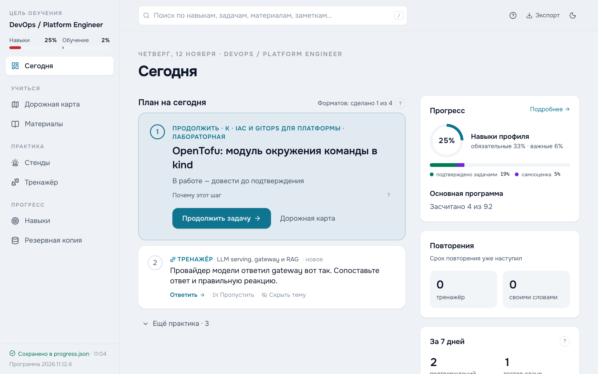
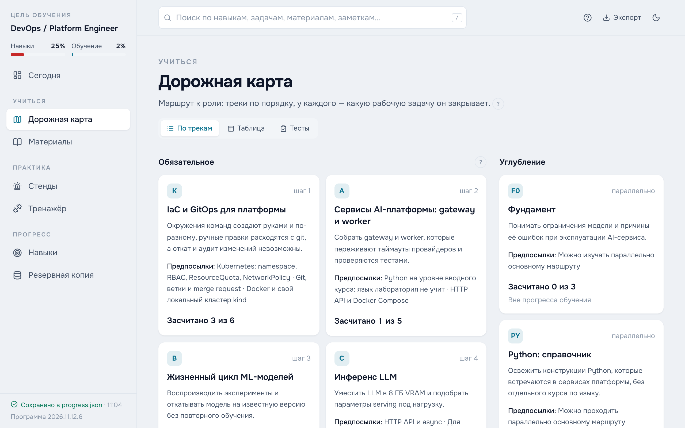
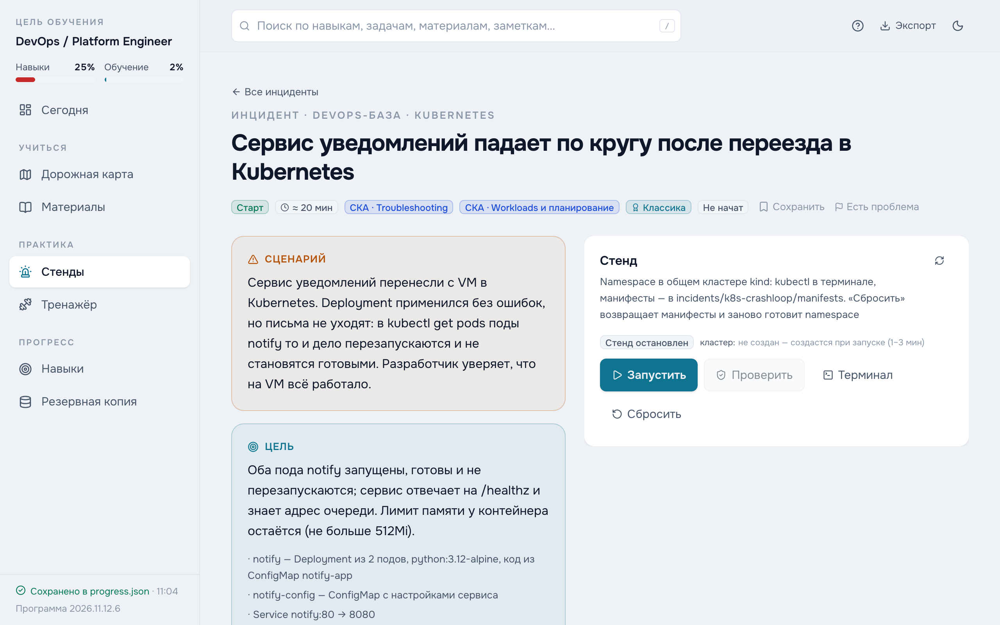

# HomeOps

**Русский** · [English](README.en.md)

Открытая домашняя лаборатория для **DevOps / Platform Engineer** со специализацией **ML/AI-платформа**: программа по требованиям рынка, сломанные стенды с автопроверкой и тренажёр с разборами. Всё работает локально в Docker.

<picture>
  <source media="(prefers-color-scheme: dark)" srcset="docs/screenshots/today-dark.png">
  
</picture>

## Зачем

Похожие тренажёры, стенды и тесты обычно продаются за серьёзные деньги. Здесь то же самое открыто — для тех, кто хочет разобраться в платформенной инженерии руками, на своей машине.

- **Программа собрана по рынку.** Профили навыков составлены по анализу открытых вакансий в России и за рубежом.
- **Практика проверяется, а не отмечается.** Стенд засчитывает автопроверка по итоговому состоянию системы, задачу — критерии приёмки и подтверждение результата.
- **Ответы разобраны.** У каждого варианта в тестах объяснено, почему он верен или в чём заблуждение.
- **Никакого ложного прогресса.** Открытая страница или поставленная галочка уровень не поднимают.

## Для кого

Для всех, кто хочет отработать навыки DevOps и платформенной инженерии руками, а не только прочитать о них.

- **Если вы только начинаете**, начните со стендов уровня «Старт» по Linux, Docker и Kubernetes, конспектов и тренажёра: подсказки ведут от направления к конкретике, а после решения разбор объясняет причину поломки.
- **Если вы уже работаете** с Linux, Docker, Kubernetes и CI/CD, основная программа ведёт в платформенную инженерию: инфраструктура как код, GitOps, эксплуатация кластеров и баз, наблюдаемость, а при желании — платформа для ML и LLM. Её задачи рассчитаны на базовый опыт с этими инструментами.

**Языки программирования лаборатория не учит.** Python и Go системно изучают на [Stepik](https://stepik.org) и похожих площадках. В программе есть справочный трек «Python: справочник» с короткими упражнениями по коду, который встречается в сервисах платформы.

## Что внутри

- **Программа** — 11 основных треков и 92 задачи с критериями приёмки и пошаговыми планами, из них 69 практических; 305 материалов, у каждой из этих задач есть материал на русском. Маршрут начинается с платформенной базы — IaC и GitOps, затем сервисы и автоматизация; дальше специализация — жизненный цикл моделей, инференс LLM, наблюдаемость, RAG, оценка качества, CI/CD с проверкой качества модели, GPU, агентные системы и дообучение.
- **Стенды** — 62 сломанных стенда в Docker: Linux, Docker, Kubernetes по доменам CKA, PostgreSQL, Redis, CI/CD и MLOps. Терминал в браузере, подсказки от направления к конкретике, разбор после решения. 13 залов — короткие цепочки подходов на беглость.
- **Тренажёр** — 1067 вопросов в 24 банках и 410 вопросов контрольных тестов, в том числе по выводу команд; 43 упражнения: порядок шагов, сопоставление, поиск ошибки, сборка архитектуры.
- **Своими словами** — 177 вопросов на объяснение: ответ вслух, оценка вслепую, сверка с ключевыми тезисами и типичной ошибкой, повторение по сроку.
- **Проектирование** — 7 кейсов system design: свой ответ, отметка аспектов, затем разбор-ориентир и типичные ошибки.
- **Навыки** — уровни навыков по профилю роли и то, что подтянуть в первую очередь.

<picture>
  <source media="(prefers-color-scheme: dark)" srcset="docs/screenshots/roadmap-dark.png">
  
</picture>

<picture>
  <source media="(prefers-color-scheme: dark)" srcset="docs/screenshots/incident-dark.png">
  
</picture>

## Минимальные требования

- **Система** — macOS на Apple Silicon, Windows 11 с WSL2 или Linux. Образы собираются для amd64 и arm64.
- **Docker** — Docker Desktop на Mac и Windows, Docker Engine на Linux; нужны Compose и buildx.
- **Память** — 16 ГБ RAM. Тяжелее всего кластер kind для Kubernetes-стендов (около 1 ГБ без нагрузки) и Airflow (около 1,2 ГБ).
- **Диск** — около 20 ГБ под образы и тома стендов без GPU, плюс кэш сборки Docker.
- **GPU** — только для части лабораторных специализации: NVIDIA с 8 ГБ видеопамяти в Windows 11 + WSL2 или Linux, подготовка — в [WINDOWS.md](WINDOWS.md); образ vLLM и веса моделей требуют отдельного места на диске. Без GPU эти задачи помечаются зависимыми от окружения и не мешают остальной программе.

## Запуск

```sh
git clone https://github.com/achrysta/HomeOps.git homeops
cd homeops
docker compose up -d --build
```

Первая сборка образов занимает несколько минут, затем дашборд открывается на **http://localhost:8080**.

| Что сделать | Как |
| --- | --- |
| Обновить | `git pull`, затем снова `docker compose up -d --build` |
| Запустить или остановить стенд | Кнопками в разделе «Стенды» — отдельные команды не нужны |
| Остановить лабораторию | Сначала остановить запущенные стенды в разделе «Стенды», затем `docker compose down` |

Прогресс хранится в `data/` и переживает остановку и обновление. Для Kubernetes-стендов лаборатория сама создаёт локальный кластер kind при запуске первого такого стенда и удаляет его, когда остановлен последний.

## С чего начать

1. **Укажите свой опыт.** По умолчанию все уровни нулевые. В «Навыках» откройте навык и отметьте самооценку с обоснованием — где и что делали. Без обоснования самооценка не учитывается.
2. **Пройдите входную диагностику** («Дорожная карта» → «Тесты»): она подскажет, что почитать, и ничего не засчитывает.
3. **Откройте «Сегодня»:** там главный шаг программы и один формат практики на день.
4. **Выполняйте задачи:** план, критерии приёмки, подтверждение результата.
5. **Решайте стенды без разбора:** самостоятельное решение подтверждает навык уровнем 2, решение после разбора — уровнем 1.

## Разделы

| Раздел | Для чего |
| --- | --- |
| **Сегодня** | Главный шаг, рекомендуемая практика и план на день. |
| **Дорожная карта** | Треки, предыдущие задачи и задачи; вкладки «Таблица» и «Тесты» (контрольные тесты и входная диагностика). |
| **Материалы** | Учебные источники и вкладка «Конспекты и шпаргалки»: краткая теория, команды, ссылки на практику. |
| **Стенды** | Инциденты — сломанные системы с терминалом, проверками и разбором, факультативный экзамен Kubernetes; залы — короткие цепочки подходов с живой проверкой. |
| **Тренажёр** | Вопросы и упражнения с повторением по сроку; вкладки «Своими словами» и «Проектирование». |
| **Навыки** | Профиль роли, уровни навыков и что их подтверждает. |
| **Резервная копия** | Экспорт, импорт, снимки прогресса и замечания к программе. |

## Прогресс и резервная копия

Прогресс сохраняется в **`data/progress.json`** в папке проекта; браузер хранит лишь кэш. Снимки создаются в **`data/backups/`** ежедневно и перед импортом или сбросом, хранятся последние 60. Папка `data/` не входит в Git и переживает перезапуск Docker.

Для переноса на другую машину — **«Экспорт»** в шапке или на «Резервной копии»; там же импорт файла и восстановление снимка с предпросмотром изменений.

У задачи, вопроса, материала и стенда есть кнопка **«Есть проблема»**: так отмечают неверный разбор, битую ссылку или непонятную формулировку. Исправления и новые стенды можно предложить через issues и pull requests.

## Безопасность

Сервис стендов управляет контейнерами через сокет Docker — это права администратора на машине. Порты дашборда и сервиса стендов привязаны к `127.0.0.1`; не открывайте их в сеть и не запускайте лабораторию на общем сервере.

## Лицензия

Код — [MIT](LICENSE). Учебные тексты — программа, вопросы, разборы и описания стендов — [CC BY-SA 4.0](LICENSE-CONTENT.md).

## Для разработчиков

- **[AGENTS.md](AGENTS.md)** — карта кода, инварианты, правила контента, безопасность и проверки.
- **[incidents/README.md](incidents/README.md)** — устройство и разработка стендов.
- **[scripts/README.md](scripts/README.md)** — изолированный автопрогон стендов.
- **[scripts/models/README.md](scripts/models/README.md)** — протоколы и измеренные профили моделей.
